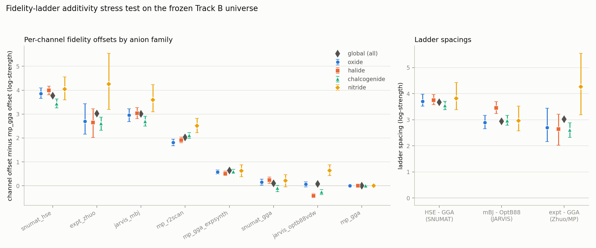

# Family-resolved fidelity-ladder offsets (additivity stress test)

Question: are the per-channel offsets of the pooled cross-channel
Plackett-Luce trial (hypergraph_trial_bandgap.py) chemistry-dependent,
or is one additive offset per channel enough? Fits below restrict the
frozen band-gap archive universe to one anion family at a time. Under a
single-family restriction the trial's within-channel events are
degenerate (one class) and carry no offset information (the channel
factor cancels within a channel), so each family fit is the pooled
model on that family's cross-channel bridge events -- exactly the
offset-identifying sub-likelihood of the trial.

Universe: `shared/output/bandgap_archive_build/bandgap_universe.jsonl` (192257 of 261053 records used, gap > 0.01 eV). Channels kept: `expt_zhuo`, `jarvis_mbj`, `jarvis_optb88vdw`, `mp_gga`, `mp_gga_expsynth`, `mp_r2scan`, `snumat_gga`, `snumat_hse`.

Gauge: Offsets are zero-mean in log space over present channels (the trial's gauge: geometric mean 1). offsets_ref are delta_c - delta_mp_gga (gauge-invariant); spacings are gauge-invariant.

Bootstrap: B = 200 refits per fit, resampling bridge
events with replacement; CIs are percentile [2.5, 97.5].
Seed = 0.

## Records and events per family

| channel | oxide records / bridge-events | halide records / bridge-events | chalcogenide records / bridge-events | nitride records / bridge-events |
|---|---|---|---|---|
| expt_zhuo | 551 / 124 | 420 / 113 | 2220 / 607 | 71 / 28 |
| jarvis_mbj | 3032 / 794 | 2459 / 1046 | 1862 / 1268 | 473 / 298 |
| jarvis_optb88vdw | 9623 / 1830 | 6507 / 2204 | 3826 / 2042 | 1022 / 511 |
| mp_gga | 54102 / 2472 | 21859 / 2347 | 9487 / 1561 | 2945 / 489 |
| mp_gga_expsynth | 13295 / 1279 | 7977 / 861 | 3334 / 673 | 1016 / 174 |
| mp_r2scan | 5517 / 1478 | 4255 / 1846 | 2630 / 1930 | 475 / 353 |
| snumat_gga | 3737 / 1553 | 2767 / 1546 | 2167 / 1861 | 483 / 386 |
| snumat_hse | 3866 / 1571 | 2798 / 1557 | 2268 / 1906 | 501 / 390 |
| total bridge events | 4000 | 4000 | 3517 | 901 |

## Channel offsets by family (zero-mean gauge, with bootstrap CI)

| channel | global | oxide | halide | chalcogenide | nitride |
|---|---|---|---|---|---|
| snumat_hse | +2.188 [+2.044, +2.314] | +2.347 [+2.166, +2.519] | +2.506 [+2.368, +2.673] | +2.053 [+1.949, +2.173] | +2.054 [+1.757, +2.385] |
| expt_zhuo | +1.441 [+1.109, +1.713] | +1.186 [+0.741, +1.818] | +1.155 [+0.581, +1.682] | +1.220 [+0.999, +1.434] | +2.274 [+1.386, +3.393] |
| jarvis_mbj | +1.434 [+1.295, +1.568] | +1.443 [+1.194, +1.649] | +1.541 [+1.355, +1.757] | +1.311 [+1.185, +1.467] | +1.613 [+1.227, +2.016] |
| mp_r2scan | +0.443 [+0.373, +0.508] | +0.293 [+0.180, +0.410] | +0.423 [+0.327, +0.512] | +0.730 [+0.682, +0.785] | +0.524 [+0.324, +0.692] |
| mp_gga_expsynth | -0.943 [-1.069, -0.828] | -0.944 [-1.099, -0.816] | -0.981 [-1.118, -0.850] | -0.797 [-0.905, -0.676] | -1.361 [-1.703, -1.085] |
| snumat_gga | -1.481 [-1.611, -1.366] | -1.360 [-1.523, -1.217] | -1.247 [-1.396, -1.116] | -1.488 [-1.594, -1.401] | -1.768 [-2.049, -1.523] |
| jarvis_optb88vdw | -1.505 [-1.602, -1.406] | -1.449 [-1.579, -1.331] | -1.909 [-2.050, -1.800] | -1.645 [-1.754, -1.542] | -1.351 [-1.606, -1.133] |
| mp_gga | -1.577 [-1.705, -1.459] | -1.516 [-1.644, -1.398] | -1.488 [-1.621, -1.374] | -1.385 [-1.487, -1.279] | -1.986 [-2.338, -1.783] |

## Ladder spacings (gauge-invariant) and the additivity test

| spacing | global | oxide | halide | chalcogenide | nitride | max pairwise diff | extreme CIs disjoint? |
|---|---|---|---|---|---|---|---|
| `snumat_hse` - `snumat_gga` | +3.669 [+3.468, +3.879] | +3.707 [+3.526, +3.977] | +3.753 [+3.581, +3.961] | +3.541 [+3.389, +3.706] | +3.822 [+3.381, +4.426] | 0.281 (nitride - chalcogenide) | False |
| `jarvis_mbj` - `jarvis_optb88vdw` | +2.939 [+2.730, +3.116] | +2.892 [+2.649, +3.169] | +3.450 [+3.235, +3.689] | +2.956 [+2.785, +3.162] | +2.964 [+2.573, +3.525] | 0.557 (halide - oxide) | True |
| `expt_zhuo` - `mp_gga` | +3.018 [+2.638, +3.416] | +2.702 [+2.158, +3.438] | +2.643 [+2.027, +3.216] | +2.605 [+2.325, +2.877] | +4.260 [+3.193, +5.546] | 1.656 (nitride - chalcogenide) | True |

Family spacing minus global spacing:

- `hse_minus_gga_snumat`: oxide +0.038, halide +0.084, chalcogenide -0.128, nitride +0.153
- `mbj_minus_optb88_jarvis`: oxide -0.047, halide +0.511, chalcogenide +0.017, nitride +0.025
- `expt_minus_gga_mp`: oxide -0.315, halide -0.375, chalcogenide -0.413, nitride +1.242

## Held-out predictive check (80/20, seeded)

- events: 9935 train / 2483 test (bridge events only; see note)
- mean per-event log-likelihood, family-resolved minus global: +0.01094, bootstrap CI [+0.00507, +0.01678]
- parameters (channel offsets): global 8 (7 free) vs family-resolved 32 (28 free)
- held-out events containing a channel unseen in training: 0
- per family: chalcogenide: +0.00654 (n=703), halide: +0.00714 (n=800), nitride: +0.05370 (n=180), oxide: +0.00898 (n=800)

Note: Bridge events only: they alone carry offset information and route to a unique family. Global model refitted on the pooled training events (same pool as the family models) for an apples-to-apples comparison.

## Verdict

CHEMISTRY-DEPENDENT: ladder spacings differ across families beyond bootstrap uncertainty AND the family-resolved model wins the held-out comparison. Additivity is violated at the current resolution.

## Interpretation

The hybrid-functional rung of the ladder is widest for nitrides (delta(snumat_hse) - delta(snumat_gga) = +3.822) and narrowest for chalcogenides (+3.541), a stretch of 0.281 log-strength units against a global value of +3.669. Within bootstrap uncertainty, however, the families' spacings are statistically compatible, so at this resolution the frozen universe does not force a chemistry-dependent correction on this rung. For routing advice between channels this reads as: GGA -> HSE (SNUMAT): worth +3.822 for a nitride campaign vs +3.541 for a chalcogenide campaign; OptB88vdW -> TB-mBJ (JARVIS): worth +3.450 for a halide campaign vs +2.892 for an oxide campaign; MP GGA -> experiment: worth +4.260 for a nitride campaign vs +2.605 for a chalcogenide campaign. The held-out check agrees: routing each event to its family's offsets gains +0.0109 log-likelihood per event (CI [+0.0051, +0.0168]) over the single additive model, at the cost of 28 vs 7 free offset parameters. A family-resolved (representation-sharing) upgrade to the pooled model must capture at least this.

